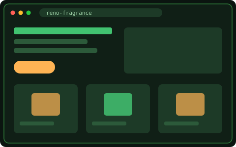
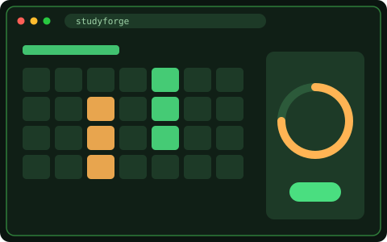
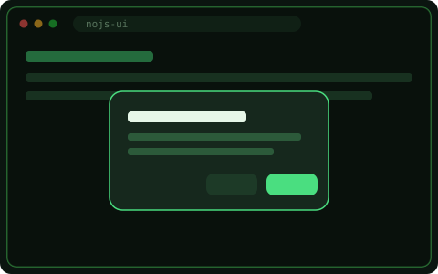

<div align="center">

<p>
  <a href="https://bz-protfolio.netlify.app/"></a>
  <a href="https://www.linkedin.com/in/badhruz-zaman"></a>
  <a href="mailto:bzprince07@gmail.com"></a>
  <a href="https://www.facebook.com/b.zaman.prince"></a>
  <a href="https://www.instagram.com/bz_._prince"></a>
</p>
</div>
~/projects.json
<table>
  <tr>
    <td width="50%" valign="top">
      <a href="TODO-RENO-LIVE-URL"></a>
      <h3>RENO Fragrance</h3>
      <p>Luxury store for international perfumes and oriental attars, with a scent finder.</p>
      <p><code>Web</code> <code>Design</code> <code>Cart</code></p>
      <p><a href="TODO-RENO-LIVE-URL"><b>View live</b></a></p>
    </td>
    <td width="50%" valign="top">
      <a href="TODO-HISHABHUB-LIVE-URL"></a>
      <h3>HishabHub</h3>
      <p>Control center for small businesses: products, orders, expenses and profit.</p>
      <p><code>Web App</code> <code>Business</code></p>
      <p><a href="TODO-HISHABHUB-LIVE-URL"><b>View live</b></a></p>
    </td>
  </tr>
  <tr>
    <td width="50%" valign="top">
      <a href="TODO-STUDYFORGE-LIVE-URL"></a>
      <h3>StudyForge</h3>
      <p>AI study planner: exam dates and subjects become a schedule plus a focus timer.</p>
      <p><code>Web App</code> <code>AI</code> <code>Planner</code></p>
      <p><a href="TODO-STUDYFORGE-LIVE-URL"><b>View live</b></a></p>
    </td>
    <td width="50%" valign="top">
      <a href="https://bzprince.github.io/nojs-ui/"></a>
      <h3>nojs-ui</h3>
      <p>Modal, drawer, menu, tabs and accordion in pure HTML and CSS. No JavaScript.</p>
      <p><code>HTML</code> <code>CSS</code> <code>Open source</code></p>
      <p><a href="https://bzprince.github.io/nojs-ui/"><b>View demo</b></a> · <a href="https://github.com/bzprince/nojs-ui">Source</a></p>
    </td>
  </tr>
</table>
Next project is in progress.
~/skills.json
Design	Web	Tools
Figma<br>Canva<br>Branding	HTML<br>CSS<br>JavaScript	VS Code<br>Git<br>GitHub
<p align="center">
  
</p>
~/about.js
```js
const prince = {
  studying: "CSE @ UIU",
  location: "Dhaka, Bangladesh",
  focus: ["Web", "UI/UX", "Branding"],
  learning: ["JavaScript", "modern CSS"],
  openToWork: true,
};
```
~/now.sh
```bash
$ git checkout -b learning        # front-end & modern UI
$ git commit -m "build projects"  # growing my portfolio
$ git push origin opportunities   # open to internships & collaboration
```
~/contributions.log
<p align="center">
  
</p>
<p align="center">Thanks for visiting.</p>
